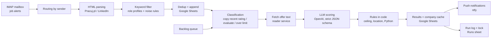

# Job offer triage: AI-assisted pipeline for job alert e-mails

A production Node.js/TypeScript application that turns a flood of job-alert e-mails into a short, reasoned shortlist on my phone. It reads alert e-mails, filters offers by role profiles, fetches the full offer text, scores each offer against a candidate profile and CV with an LLM (OpenAI, structured output), enforces hard rules in code, stores everything in Google Sheets and sends push notifications.

It runs three times a day as a cron job on Railway (Docker), with the same code runnable on a laptop.

> **Sample data.** This public repository uses a **fictional candidate** (profile, CV, location, salary threshold) and placeholder IDs. My real profile, CV, spreadsheet and notification topic live only in a private repository. Code comments and CLI command names are in Polish, the working language of the project.

## What it does

1. **Collects** unread job-alert e-mails over IMAP (Pracuj.pl and LinkedIn alerts), routed by sender; other e-mails are left untouched.
2. **Parses** offers from the alert HTML with CSS selectors and normalizes them (title, company, location, clean URL, dedup key). An e-mail whose structure does not add up (e.g. 5 titles but 4 URLs) is skipped and reported instead of producing misaligned rows.
3. **Pre-filters** titles with keyword profiles and noise rules, so only relevant offers reach the (paid) AI step.
4. **Deduplicates** against the spreadsheet and appends new offers; the e-mail is marked as read only after the rows are saved.
5. **Fetches the full offer page** through a reader service (with block / expired-offer detection) and builds a clean description.
6. **Scores the offer with an LLM** using a 3-step methodology (role profiles, CV evidence per requirement, mandate signals) via a strict JSON schema (function calling).
7. **Applies hard rules in code**: the model only reports facts (e.g. number of unmet hard requirements, on-site location, "advanced Python required"), the code decides the ceiling for the recommendation. The raw model answer and the applied rule are kept for audit.
8. **Writes 25 result columns** to Google Sheets, keeps a company cache and a backlog queue for offers not evaluated in this run.
9. **Notifies** via ntfy: ratings (split into parts that the phone can actually display), problems of the run, and a daily heartbeat.
10. **Logs every run** in a "Runs" sheet with counters, and uses it as a lock against two concurrent runs.

## Architecture



## Key design decisions

- **The LLM proposes, the code decides.** The model fills a strict schema (unmet hard requirements, location mode, "advanced Python required", company facts). `src/eval/rules.ts` enforces the thresholds: 2 unmet hard requirements cap the recommendation at "watch", 3+ force "skip", a full-time on-site role in another city forces "skip", a required professional-level Python forces "skip". The code never raises a rating. Columns `rekomendacja_ai` (raw model answer), `regula_kodu` (applied rule) and `wersja_promptu` (methodology + CV version) make every decision auditable.
- **Cost and stability of the LLM call.** The system prompt and tool schema form a stable prefix, so prompt caching works across offers (visible in the token-usage column). Company facts are cached in a separate sheet and passed to the model as known, so it does not re-guess them. Repeated offers (same company and title) reuse the last rating within 30 days, and duplicates within one run are evaluated once.
- **Safe, idempotent runs.** Dedup key per offer, e-mails marked as read only after saving, a backlog queue for offers that hit the per-run limit or the soft time limit, a lock row in the run log, a `--dry-run` mode that writes nothing (and calls the LLM only with `--z-ai`), and a failure push with the stage where the run stopped.
- **Measured, not assumed.** Notification limits were found by testing on a real iPhone: messages around 3.7 KB (or 2.7 KB with high priority) reach the app but show no notification, so ratings are split into parts of at most 2,800 bytes with normal priority, "apply" offers always first with full reasoning, and the run date and time in the first line.
- **One codebase, two runtimes.** Laptop (manual run or Windows Task Scheduler) and Railway (Docker image, cron), configuration from environment variables validated with `zod`. Service-account credentials are passed as a file locally and as a base64 variable in the cloud.
- **Migration with a safety net.** The system started as an n8n workflow. When n8n was no longer available, it was rebuilt as this application, and the new code was checked with "golden" tests that ran the frozen n8n node code and the new TypeScript code on the same inputs (including real e-mails) and compared the outputs. Those tests and fixtures contain personal data, so they are not part of this public repository; the tests here use synthetic data.

## Tests

84 tests with Vitest, all on synthetic data and in-memory doubles (spreadsheet, reader service, OpenAI, ntfy), no network calls:

- `test/unit/przebieg.test.ts`: the whole run end to end: alert e-mails, filter, dedup, fetch, LLM scoring, rules, results, push, run log; second run deduplicates; dry run writes nothing.
- `test/unit/ocena.test.ts`: description building, company cache, request shape, response parsing and every code rule.
- `test/unit/pushe.test.ts`: notification format, splitting within the byte limit, problems report, daily heartbeat.
- `test/unit/kolejka.test.ts`, `powtorki.test.ts`, `arkusz.test.ts`, `cv.test.ts`: backlog queue, duplicate handling, sheet contract, CV conversion from `.docx`.

```bash
cd app
npm ci
npm test
```

## Tech stack

Node.js 24, TypeScript, Vitest, `imapflow` + `mailparser` (IMAP), `cheerio` (HTML), Google Sheets API (service account), OpenAI Responses API (function calling, strict schema), Jina Reader (page text), ntfy (push), `zod` (config), Docker, Railway (cron).

## Project structure

```
app/
  src/
    cli.ts              commands: sprawdz (diagnostics), run, odswiez-cv (CV for the model from .docx)
    pipeline.ts         one run, step by step
    mail/               IMAP, MIME parsing, routing by sender
    sources/            alert parsers (Pracuj.pl, LinkedIn)
    filter/             keyword profiles and noise rules
    eval/               classification, backlog, fetch, description, prompt, OpenAI call, rules
    sheets/             Google Sheets client, offers sheet contract, dates
    notify/             ratings push, problems push, heartbeat, ntfy
    cv/                 .docx -> markdown CV for the model, with quality checks
    runlog.ts           run log and lock
  dane/cv.md            sample CV (fictional candidate)
  test/unit/            tests on synthetic data
  Dockerfile, railway.json
```

## Running it

```bash
cd app
npm ci
cp .env.example .env      # fill in: IMAP, Google service account, sheet ID, OpenAI key, ntfy topic
npm run build
node dist/cli.js sprawdz                          # diagnostics: config, sheet, headers, IMAP, OpenAI, test push
node dist/cli.js run --eml <folder with .eml> --dry-run   # preview on saved e-mails, writes nothing
node dist/cli.js run                              # real run on unread alerts
```

## How it was built

Designed and operated by Jakub Skowroński; implemented through AI-assisted development (Claude Code), with requirements, decisions, acceptance tests and staged rollouts defined and reviewed by me.

## License

MIT, see [LICENSE](LICENSE).
